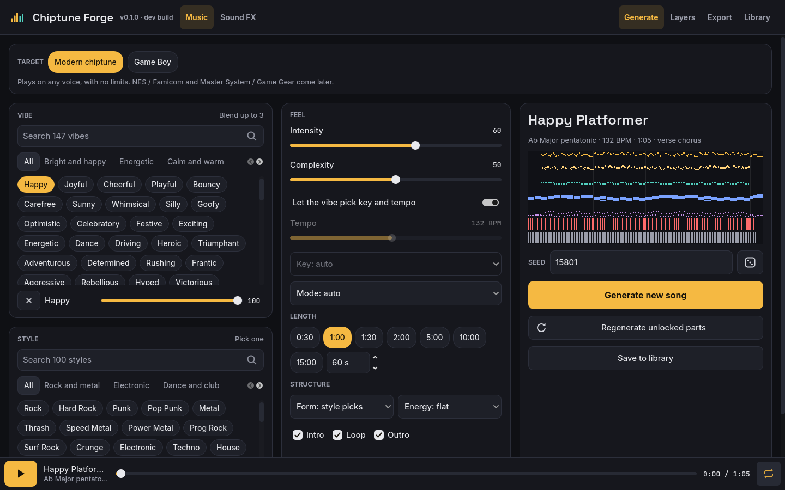
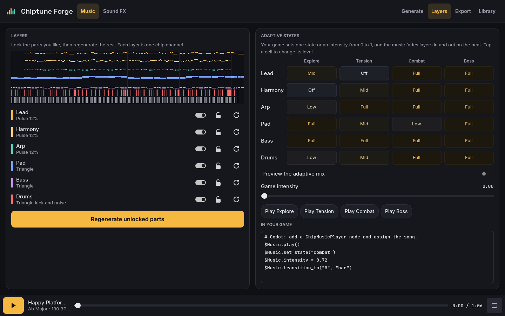
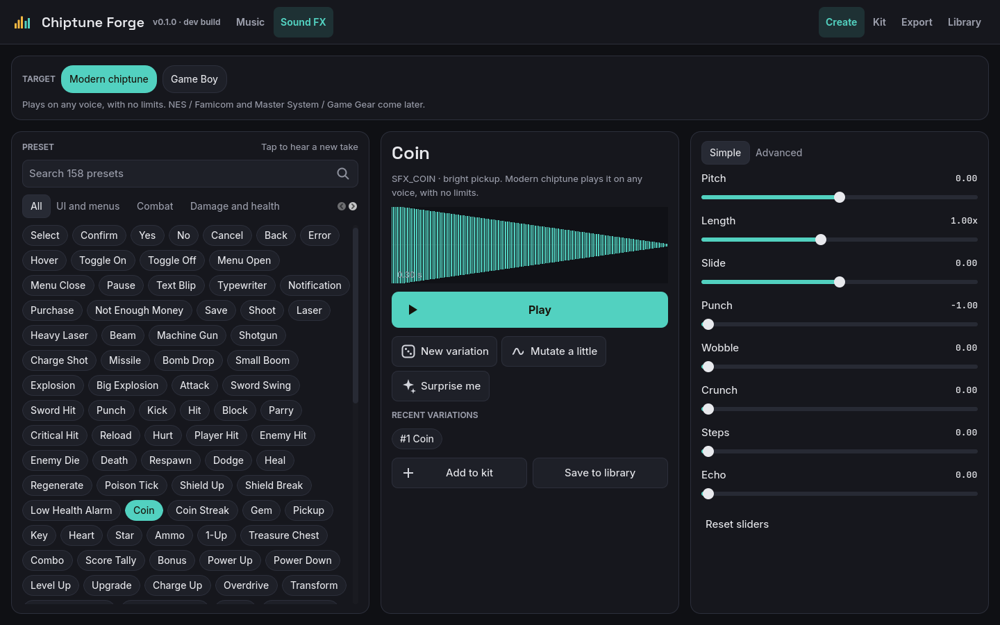
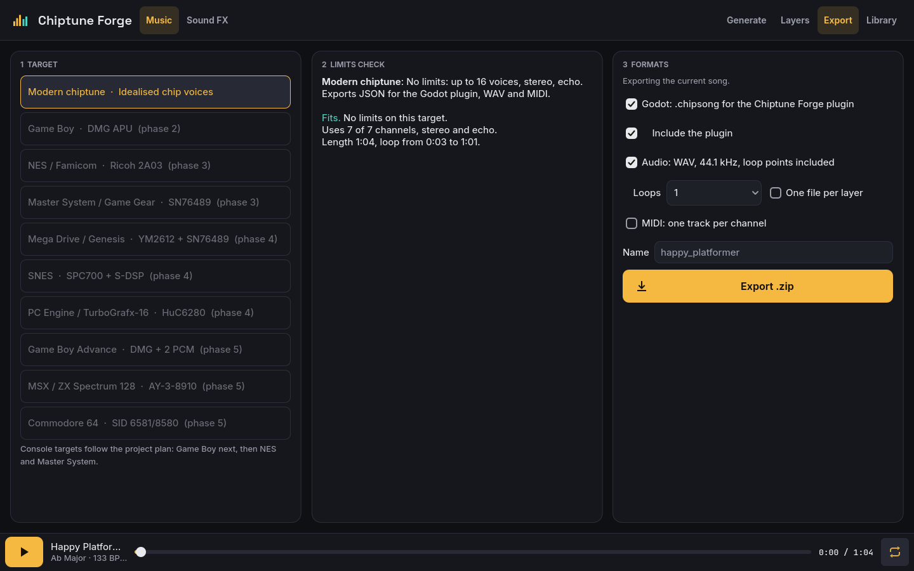
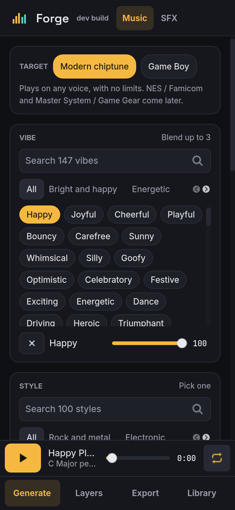
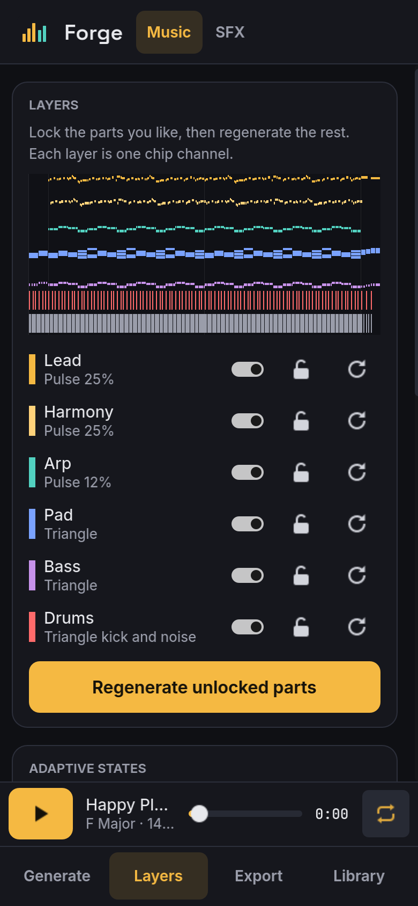
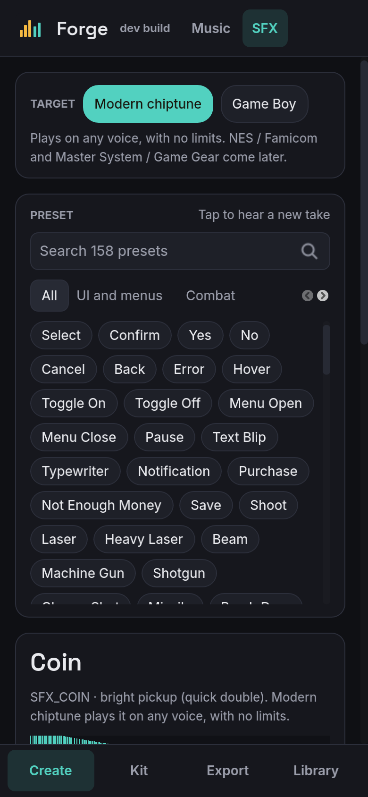

# Chiptune Forge

Chiptune Forge makes royalty-free chiptune music and retro sound effects for
games. Pick a vibe and a style, press Generate, and keep what you like. It
runs on phones, desktops and the web, and it exports straight into Godot.

- **Music mode.** 147 vibes in 11 categories and 100 styles in 9 families.
  Blend up to three vibes, set intensity, complexity, tempo, key, form and
  length, then lock the layers you like and regenerate the rest.
- **Sound FX mode.** About 160 presets in 12 categories, from menu clicks to
  boss roars. Every tap gives a new take; mutate it, tweak it and collect the
  keepers into a sound kit.
- **Adaptive music.** Every song has layers and four states (Explore,
  Tension, Combat, Boss) that the Godot plugin can fade between by intensity.
- **Exports.** `.chipsong`, `.chipsfx` and `.chipkit` JSON for the Godot
  plugin, WAV with loop points (or one WAV per layer), and MIDI.
- **Game Boy target.** Pick the Game Boy on the Export screen and the song is
  arranged for its four channels, previews play through an emulated Game Boy
  sound chip, and the export is a GBDK-2020 project (C data for hUGEDriver,
  an example `main.c` and a Makefile) that builds into a ROM. Sound effects
  convert too, with a small player that shares a channel with the music.
- **NES target.** Pick the NES and the song is arranged for the 2A03's two
  pulses, triangle and noise, previews play through an emulated NES sound
  chip, and the export is a [FamiStudio](https://famistudio.org) project that
  FamiStudio turns into data for its sound engine, an NSF or a ROM. Sound
  effects export as a FamiStudio sound effect project.
- **Seeds.** The same settings and seed always give the same song, on every
  platform.

Everything you make is yours, for any use, with no royalties or credit
required.

## Screenshots



<table>
  <tr>
    <td></td>
    <td></td>
  </tr>
  <tr>
    <td align="center">Layers and adaptive states</td>
    <td align="center">Sound FX mode</td>
  </tr>
  <tr>
    <td colspan="2"></td>
  </tr>
  <tr>
    <td colspan="2" align="center">Export</td>
  </tr>
</table>

On a phone the same screens stack into one column with navigation at the
bottom:

<p align="center">
  
  
  
</p>

## Running it

Play it in your browser at https://xsoc.github.io/chiptune-forge/ (deployed
from `main` on every push).

Or open the project in Godot 4.5 or later and press Play. Export presets for
Web, Linux, Windows, macOS and Android are included; see
[CONTRIBUTING.md](CONTRIBUTING.md) for building them.

## Using the Godot plugin

The plugin lives in `addons/chipforge/` and is also bundled in every export
zip. Copy that folder into your game, enable **Chiptune Forge** under
Project Settings > Plugins, and drop in your exported files: Godot imports
`.chipsong`, `.chipsfx` and `.chipkit` files as resources.

```gdscript
# Music: add a ChipMusicPlayer node and assign the song.
$Music.play()
$Music.intensity = 0.7          # adaptive: picks the Combat state
$Music.set_state("Boss")        # or choose a state directly
$Music.set_layer("Lead", "off") # or fade a single layer
$Music.transition_to("B", "bar")
$Music.bar.connect(func(i): print("bar ", i))

# Sound effects: add a ChipSfxPlayer node and assign the kit.
$Sfx.play("jump")
$Sfx.play("coin", 1.2)          # a little higher
```

The synth is pure GDScript, so the plugin works on every platform Godot
exports to, including the web, with nothing to compile. The file formats are
described in [docs/format.md](docs/format.md).

## Project layout

| Folder | What is in it |
|---|---|
| `addons/chipforge/` | The Godot plugin: resources, importers, synth and player nodes. MIT, self-contained. |
| `autoload/` | `AppState` (settings, current song, library) and `AudioService` (preview players). |
| `scenes/` | One scene per screen and per reusable control. |
| `scripts/generation/` | The generators. Plain `RefCounted` code with no scene dependencies. |
| `scripts/export/` | WAV, MIDI and zip export. |
| `scripts/targets/gameboy/` | Game Boy target: sound chip emulation, hUGEDriver player, arranger, SFX conversion and C writer. |
| `scripts/targets/nes/` | NES target: 2A03 emulation, a player that follows FamiStudio's sound engine, arranger, SFX conversion and the FamiStudio text writer. |
| `assets/gameboy/hUGEDriver/` | The vendored hUGEDriver source bundled with Game Boy exports. |
| `resources/` | Vibes, styles, SFX presets and chip profiles as `.tres` files, plus the theme. |
| `tests/` | Unit and golden-file tests. |
| `tools/` | Theme builder, screenshot tool, and the Game Boy and NES checks CI runs. |

## Roadmap

Phase 1 is modern chiptune with no hardware limits. Phase 2 adds the Game Boy:
an arranger that fits songs to its four channels, an emulated sound chip for
previews, and C export for GBDK-2020 and hUGEDriver. CI builds example ROMs
from the export and checks that they play in the PyBoy emulator. Phase 3
adds the NES: the same arranger approach for its four melodic channels, an
emulated 2A03, and FamiStudio project export. CI opens the exported projects
in FamiStudio and has it write sound engine data, NSF, ROM and WAV files from
them. The Master System comes next.

To build a Game Boy export yourself, unzip it, install
[GBDK-2020](https://github.com/gbdk-2020/gbdk-2020) and run
`make GBDK_HOME=/path/to/gbdk` in the `gameboy/` folder. The README inside
explains how to use the song and sounds in your own game.

To use an NES export, unzip it, open `nes/<name>.txt` in FamiStudio
(File > Import) and export from there, or use FamiStudio's command line as
`nes/README.txt` shows.

## Licence

MIT, see [LICENSE](LICENSE). Bundled fonts are under the SIL Open Font
Licence; see [THIRD_PARTY.md](THIRD_PARTY.md).
