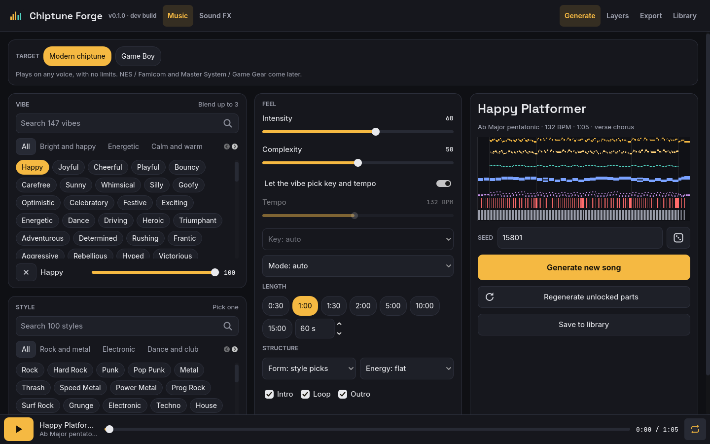
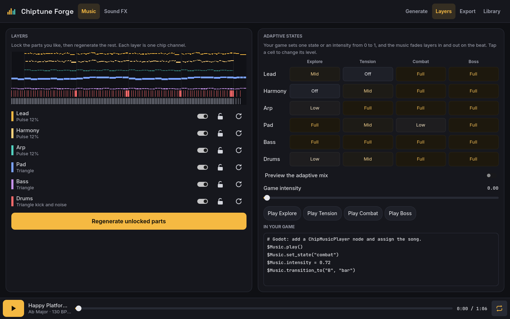
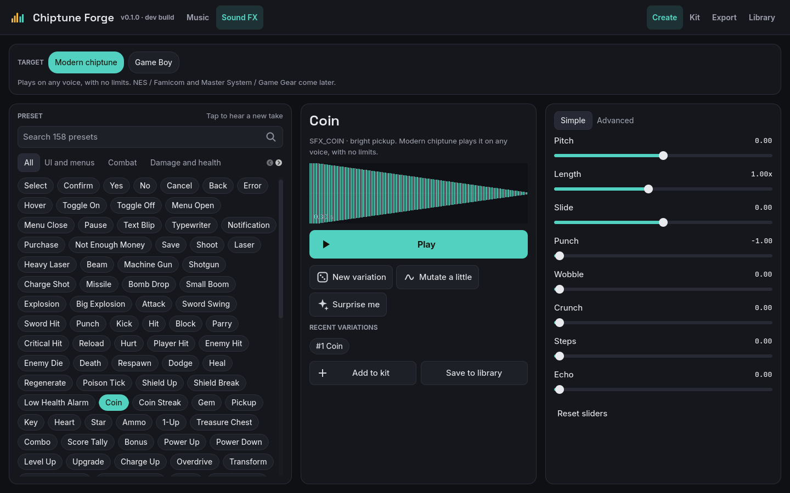
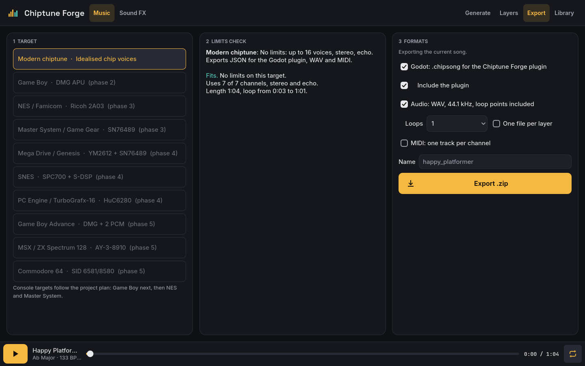
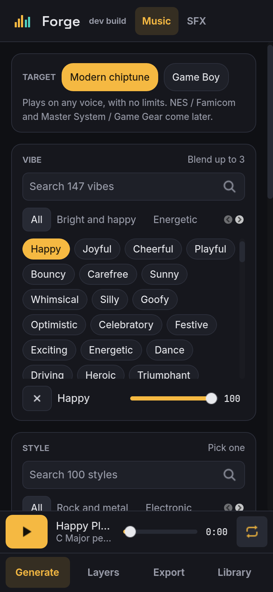
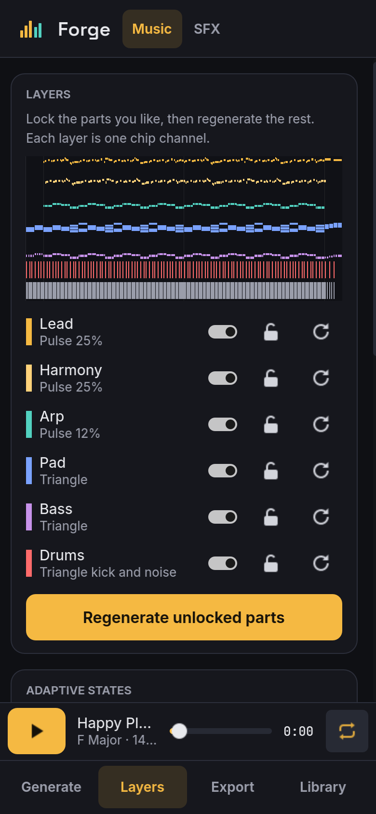
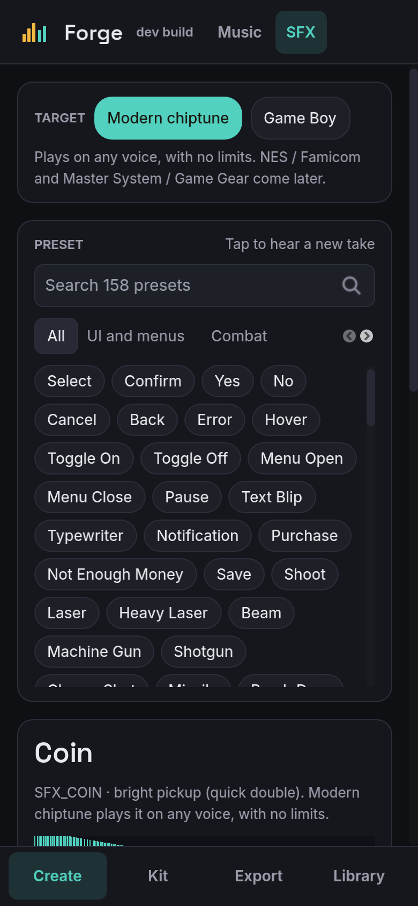

# Chiptune Forge

Chiptune Forge makes royalty-free chiptune music and retro sound effects for
games. Pick a vibe and a style, press Generate, and keep what you like. It
runs on phones, desktops and the web, and it exports straight into Godot.

- **Music mode.** 147 vibes in 11 categories and 100 styles in 9 families.
  Blend up to three vibes, set intensity, complexity, tempo, key, form and
  length, then lock the layers you like and regenerate the rest. Tap notes
  in or out of any part on the Layers screen's note grid.
- **Advanced mode.** Write or rework a song from single notes up: a piano
  roll with draw, select and erase tools and a velocity lane; copy, paste,
  duplicate, transpose and quantize bars; add, copy, repeat, reorder,
  resize and rename sections and set the loop; or start from a blank song.
  Play live on the on-screen keys, the computer keyboard or a MIDI keyboard
  (desktop and Web MIDI), record takes into any part while the song loops,
  or enter notes one at a time. Edited songs play through the same synth and
  export to every target. See [docs/advanced.md](docs/advanced.md).
- **Synth engines.** Besides the classic chip sound, songs can play on an
  analog-style subtractive synth, two-operator FM, a wavetable synth or
  samples made in the app (plucked strings, electric piano, strings, brass
  and a drum kit). Pick one per song or per layer, let the style choose, and
  press A/B to compare with the classic chip.
- **Sound FX mode.** About 160 presets in 12 categories, from menu clicks to
  boss roars. Every tap gives a new take; mutate it, tweak it and collect the
  keepers into a sound kit.
- **More targets.** The SNES (SPC700 samples for SNESMod), the PC Engine
  (wavetables for our own HuC6280 player), the Game Boy Advance (8-bit
  samples for Maxmod), the MSX and ZX Spectrum 128 (AY-3-8910, with our Z80
  player), the Commodore 64 (SID, as PSID files with our 6502 player) and
  the DOS PC (the PC speaker, as C data with our DOS player; the Tandy
  1000's SN76496 as VGM; the AdLib and Sound Blasters' OPL2, dual OPL2
  and OPL3 FM chips, as IMF, DRO and VGM files, with VOC sound effects; and
  the Roland MT-32 and Sound Canvas as MIDI files with their SysEx setup;
  and the Gravis Ultrasound as Impulse Tracker modules of generated samples).
  Each one arranges the song for the chip, previews it through an emulated
  chip and exports source, data and an example project that builds.
- **Community packs.** Add vibes, styles and sound presets that other
  people made, from one `.chippack` file each. See [packs/](packs/README.md)
  to find packs or make your own.
- **Adaptive music.** Every song has layers and states (Explore, Tension,
  Combat and Boss to start with, plus any you add) that the Godot plugin
  moves between by intensity or by name. Transition rules per route say
  when a change lands (now, or on the next beat, bar or phrase) and how
  (crossfade, cut or a stinger), and the Layers screen warns when a state
  needs more voices than the chip has. States and intensity work in the
  Godot plugin; the console exports play the song as one fixed arrangement,
  without `set_state` or intensity in their C players.
- **Exports.** `.chipsong`, `.chipsfx` and `.chipkit` JSON for the Godot
  plugin, WAV with loop points (or one WAV per layer), OGG Vorbis with loop
  tags (from our own GDScript encoder), and MIDI.
  Before export, the lead is checked against well-known public-domain tunes
  (in any key and tempo), and the Export screen warns if an eight-note
  phrase follows one.
- **Game Boy target.** Pick the Game Boy on the Export screen and the song is
  arranged for its four channels, previews play through an emulated Game Boy
  sound chip, and the export is a GBDK-2020 project (C data for hUGEDriver,
  an example `main.c` and a Makefile) that builds into a ROM. Sound effects
  convert too, with a small player that shares a channel with the music.
- **NES target.** Pick the NES and the song is arranged for the 2A03's two
  pulses, triangle and noise, previews play through an emulated NES sound
  chip, and the export is ca65 assembly for
  [FamiStudio](https://famistudio.org)'s sound engine, with the engine and an
  example program that builds a ROM with cc65. The FamiStudio project comes
  too, to edit the song or make an NSF. Sound effects export the same way.
- **Master System / Game Gear target.** Pick the Master System and the song
  is arranged for the SN76489's three squares and noise, previews play
  through an emulated SN76489, and the export is
  [PSGlib](https://github.com/sverx/PSGlib) data (a `.psg` file and a C
  array for devkitSMS) plus a VGM. Sound effects export as PSGlib sound
  effects that play over the music.
- **Mega Drive / Genesis target.** Pick the Mega Drive and the song is
  arranged for the YM2612's FM channels and the SN76489: FM lead, harmony,
  arpeggio, bass and drums, with the pad's chords on the squares. Previews
  play through an emulated YM2612 and SN76489, and the export is a VGM that
  [SGDK](https://github.com/Stephane-D/SGDK) turns into XGM music, with a
  minimal SGDK program. Sound effects export as 8-bit samples for XGM.
- **Command line.** The desktop builds and a Docker image run headless:
  `generate`, `sfx`, `export`, `batch`, `validate` and `list`, with JSON
  reports and exit codes for CI. See [docs/cli.md](docs/cli.md).
- **Seeds.** The same settings and seed always give the same song, on every
  platform.

Everything you make is yours, for any use, with no royalties or credit
required.

## Screenshots



<table>
  <tr>
    <td></td>
    <td></td>
  </tr>
  <tr>
    <td align="center">Layers and adaptive states</td>
    <td align="center">Sound FX mode</td>
  </tr>
  <tr>
    <td colspan="2"></td>
  </tr>
  <tr>
    <td colspan="2" align="center">Export</td>
  </tr>
</table>

On a phone the same screens stack into one column with navigation at the
bottom:

<p align="center">
  
  
  
</p>

## Running it

Play it in your browser at https://xsoc.github.io/chiptune-forge/ (deployed
from `main` on every push).

Or open the project in Godot 4.5 or later and press Play. Export presets for
Web, Linux, Windows, macOS and Android are included; see
[CONTRIBUTING.md](CONTRIBUTING.md) for building them.

## Using the Godot plugin

The plugin lives in `addons/chipforge/` and is also bundled in every export
zip. Copy that folder into your game, enable **Chiptune Forge** under
Project Settings > Plugins, and drop in your exported files: Godot imports
`.chipsong`, `.chipsfx` and `.chipkit` files as resources.

```gdscript
# Music: add a ChipMusicPlayer node and assign the song.
$Music.play()
$Music.intensity = 0.7          # adaptive: picks the Combat state
$Music.set_state("Boss")        # or choose a state directly
$Music.set_layer("Lead", "off") # or fade a single layer
$Music.play_stinger("rise")     # a short phrase over the music
$Music.transition_to("B", "bar")
$Music.bar.connect(func(i): print("bar ", i))
$Music.state_changed.connect(func(s): print("now in ", s))

# Sound effects: add a ChipSfxPlayer node and assign the kit.
$Sfx.play("jump")               # play_sfx("jump") does the same
$Sfx.play("coin", 1.2)          # a little higher
```

The synth is pure GDScript, so the plugin works on every platform Godot
exports to, including the web, with nothing to compile. For low-end
devices, tick **Prerender** in a `.chipsong` file's Import dock: the song
is rendered once to a looping OGG Vorbis stream, which `ChipMusicPlayer`
plays instead of synthesising live (adaptive layers need live synthesis). The file formats are
described in [docs/format.md](docs/format.md).

## Project layout

| Folder | What is in it |
|---|---|
| `addons/chipforge/` | The Godot plugin: resources, importers, synth and player nodes. MIT, self-contained. |
| `autoload/` | `AppState` (settings, current song, library) and `AudioService` (preview players). |
| `scenes/` | One scene per screen and per reusable control. |
| `scripts/generation/` | The generators. Plain `RefCounted` code with no scene dependencies. |
| `scripts/editing/` | Note, bar and section editing, live input, the live synth and the take recorder. |
| `scripts/export/` | WAV, OGG, MIDI and zip export (the Vorbis encoder is `addons/chipforge/core/chip_vorbis.gd`). |
| `scripts/targets/gameboy/` | Game Boy target: sound chip emulation, hUGEDriver player, arranger, SFX conversion and C writer. |
| `scripts/targets/nes/` | NES target: 2A03 emulation, a player that follows FamiStudio's sound engine, arranger, SFX conversion, the FamiStudio text writer and the ca65 writer for FamiStudio's sound engine. |
| `scripts/targets/sms/` | Master System target: SN76489 emulation, a player that writes PSGlib's register stream, arranger (built on the NES one), SFX conversion and the PSGlib, C and VGM writer. |
| `scripts/targets/genesis/` | Mega Drive target: YM2612 emulation (with the Master System's SN76489), FM patches, arranger, a frame-by-frame player, the VGM writer and SFX conversion. |
| `scripts/targets/snes/`, `pce/`, `gba/`, `msx/`, `c64/`, `pc/` | The SNES, PC Engine, Game Boy Advance, MSX/Spectrum, Commodore 64 and DOS PC targets, each with its chip emulation, arranger, player, SFX conversion and writers. |
| `scripts/packs/`, `packs/` | Community packs: the loader, and the packs that ship with the repository. |
| `scripts/cli/` | The headless command line ([docs/cli.md](docs/cli.md)). |
| `store/` | App store listing text ([docs/release.md](docs/release.md)). |
| `assets/gameboy/hUGEDriver/` | The vendored hUGEDriver source bundled with Game Boy exports. |
| `resources/` | Vibes, styles, SFX presets and chip profiles as `.tres` files, plus the theme. |
| `tests/` | Unit and golden-file tests. |
| `tools/` | Theme builder, screenshot tool, and the Game Boy, NES, Master System and Mega Drive checks CI runs. |

## Roadmap

Phase 1 is modern chiptune with no hardware limits. Phase 2 adds the Game Boy:
an arranger that fits songs to its four channels, an emulated sound chip for
previews, and C export for GBDK-2020 and hUGEDriver. CI builds example ROMs
from the export and checks that they play in the PyBoy emulator. Phase 3
adds the NES: the same arranger approach for its four melodic channels, an
emulated 2A03, and export as ca65 data for FamiStudio's sound engine. CI
opens the FamiStudio projects in FamiStudio, checks that its own sound engine
export matches the app's byte for byte, builds the example ROMs with cc65 and
plays them in an emulator. Then the Master System and Game Gear: the SN76489, exported as PSGlib
data. CI checks the data against PSGlib's own tools (vgm2psg, psgcomp and
psgdecomp) and compiles the C arrays with SDCC. Phase 4 brings the 16-bit
consoles, starting with the Mega Drive: CI converts the exported VGMs with
SGDK's xgmtool and checks the XGM keeps every register write, builds an
example ROM with SGDK, and compares the app's preview with libvgm's YM2612
playing the VGM and with the ROM running in Genesis Plus GX. The SNES and
PC Engine followed, then the Game Boy Advance, the MSX and ZX Spectrum, and
the Commodore 64, with the note editor and community packs. Phase 6 is the
headless command line and its Docker image. Phase 7 gives the modern
synth several new engines (analog, FM, wavetable and sampled) and adds the
DOS PC as a target with all its sound cards, from the PC speaker to the
Gravis Ultrasound. CI plays each card's files in independent players
(AdPlug's DOSBox OPL core, libvgm, FluidSynth and libopenmpt) and compares
them with the previews, and builds the PC speaker player with Open Watcom.
All seven phases are done.
[docs/release.md](docs/release.md) covers releasing to the app stores, and
[docs/privacy.md](docs/privacy.md) is the privacy policy: the app collects
no data.

To build a Game Boy export yourself, unzip it, install
[GBDK-2020](https://github.com/gbdk-2020/gbdk-2020) and run
`make GBDK_HOME=/path/to/gbdk` in the `gameboy/` folder. The README inside
explains how to use the song and sounds in your own game.

To use an NES export, unzip it, install [cc65](https://cc65.github.io) and
run `make` in the `nes/` folder to build the example ROM; `nes/README.txt`
explains how to use the song and sounds in your own game (assembly or C).
`nes/famistudio/<name>.txt` opens in FamiStudio (File > Import).

To use a Master System export, unzip it and add `sms/<name>_psg.c` to a
devkitSMS project (or `incbin` `sms/<name>.psg` in assembly), then call
`PSGPlay` once and `PSGFrame` every frame; `sms/README.txt` has the details.

To use a Mega Drive export, unzip it, put `genesis/<name>.vgm` and
`genesis/resources.res` in an SGDK project's `res/` folder and call
`XGM_startPlay(<name>)`; `genesis/main.c` is a complete example and
`genesis/README.txt` has the details.

## Licence

MIT, see [LICENSE](LICENSE). Bundled fonts are under the SIL Open Font
Licence; see [THIRD_PARTY.md](THIRD_PARTY.md).
